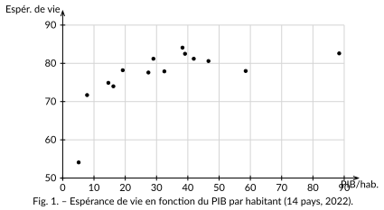

<!-- GÉNÉRÉ par typweb à partir des notes Typst : NE PAS ÉDITER (les modifications seraient écrasées). -->

Un tableau de $14$ couples est difficile à lire d’un coup d’œil. Pour *voir* la relation, on dessine.

::: {#definition-1-3 data-sorte="definition" data-num="1.3" data-page="3" data-phys="6" data-id="5UAA1.nuage-points-2" data-type="definition" data-tags="" .theo .theo-definition}
::: {.theo-head}
**Définition 1.3** — nuage de points
:::

::: {.theo-body}
Le **nuage de points** d’une série $(x_{i} ; y_{i})$ est l’ensemble des points de coordonnées $(x_{i} ; y_{i})$ placés dans un repère. Chaque point représente un individu. On ne relie **pas** les points : ils ne forment pas une courbe, mais un semis que l’on interprète globalement.
:::
:::

::: {#activite-1-2 data-sorte="activite" data-num="1.2" data-page="3" data-phys="6" data-id="5UAA1.lire-nuage-revenu-esperance-vie" data-type="activite" data-tags="" .theo .theo-activite}
::: {.theo-head}
**Activité 1.2** — lire le nuage revenu – espérance de vie
:::

::: {.theo-body}
Voici le nuage des $14$ pays du tableau ($x$ = PIB par habitant en milliers de dollars, $y$ = espérance de vie en années).

::: {.typst-fig}
{fig-alt="Figure du cours"}
:::

a) **Sens.** Quand le PIB par habitant augmente, l’espérance de vie a-t-elle plutôt tendance à augmenter ou à diminuer ? [à **augmenter** : le nuage est globalement **croissant**.]{.rep}

b) **Forme.** Les points sont-ils parfaitement alignés sur une droite ?

::: {.rep-bloc}
Non. L’espérance de vie monte **vite** pour les pays pauvres, puis **plafonne** : au-delà d’un certain revenu, gagner plus n’ajoute presque plus d’années. La tendance ressemble plus à une courbe qui s’aplatit qu’à une droite.
:::

c) **Point atypique.** Un pays riche s’écarte nettement de la tendance : lequel, et pourquoi est-ce frappant ?

::: {.rep-bloc}
Les **États-Unis** ($58{,}5$ ; $78{,}0$) : un des PIB les plus élevés, mais une espérance de vie inférieure à celle de pays bien moins riches (Portugal, Pologne…). La richesse ne suffit donc pas à tout expliquer.
:::

d) **Point moyen.** À la calculatrice, calcule les deux moyennes, puis place sur le graphique le point $G(\overline{x} ; \overline{y})$ (une croix). $\overline{x} \approx$ [$33{,}2$]{.rep} $\overline{y} \approx$ [$77{,}0$]{.rep}
:::
:::
