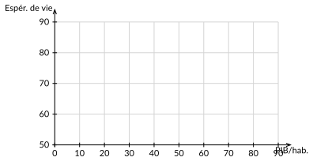
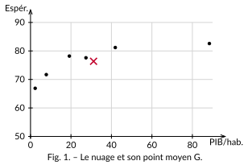

<!-- GÉNÉRÉ par typweb à partir des notes Typst : NE PAS ÉDITER (les modifications seraient écrasées). -->

::: {#exercice-1-1 data-sorte="exercice" data-num="1.1" data-page="5" data-phys="8" data-id="5UAA1.ex.001" data-type="exercice" data-tags="" .exo}
::: {.exo-tete}
[✎ Exercice 1.1]{.exo-titre} [[C1]{.exo-comp} ★☆☆]{.exo-meta}
:::

::: {.exo-corps}
Un professeur relève, pour $6$ élèves, le nombre d’heures de révision avant un test ($x$) et la note obtenue sur $20$ ($y$).

::: {.colonnes style="--n:2"}
- Quelle est la population étudiée ?
- Quels sont les deux caractères relevés ?
- Combien de couples $(x_{i} ; y_{i})$ la série compte-t-elle ?
- Écris le couple correspondant à un élève ayant révisé $3$ h et obtenu $12$.
:::
:::
:::

::: {.aides}
::: {.panel-tabset}
## Indice 1 {.unlisted}

Revois la *Définition — série statistique à deux variables* (population, individu, couple de données).

## Indice 2 {.unlisted}

*Question à te poser.* Sur **qui** ou **quoi** relève-t-on les mesures ? Et combien de nombres note-t-on **par** individu ?

## Indice 3 {.unlisted}

*Étape.* Un « couple » s’écrit $(x_{i} \, ; \, y_{i})$, dans l’ordre : d’abord la variable en abscisse, puis celle en ordonnée.

## Solution {.unlisted}

(a) Les **6 élèves**. (b) Le **temps de révision** ($x$) et la **note** ($y$). (c) **6 couples**. (d) $(3 \, ; \, 12)$.

## Pièges {.unlisted}

Confondre la population (les individus) avec les variables (ce qu’on mesure) ; inverser l’ordre du couple.
:::
:::

::: {#exercice-1-2 data-sorte="exercice" data-num="1.2" data-page="5" data-phys="8" data-id="5UAA1.ex.002" data-type="exercice" data-tags="" .exo}
::: {.exo-tete}
[✎ Exercice 1.2]{.exo-titre} [[A1]{.exo-comp} ★☆☆]{.exo-meta}
:::

::: {.exo-corps}
On reprend six pays du tableau ($x$ = PIB/hab. en milliers de \$, $y$ = espérance de vie).

::: {.tableau}
| Pays | Éthiopie | Inde | Chine | Turquie | Belgique | Norvège |
|:---:|:---:|:---:|:---:|:---:|:---:|:---:|
| $x$ | 2,3 | 7,8 | 19,2 | 27,4 | 41,9 | 88,4 |
| $y$ | 66,9 | 71,7 | 78,2 | 77,6 | 81,2 | 82,6 |
:::

a) Trace le nuage de points dans le repère ci-dessous.

b) Calcule $\overline{x}$ et $\overline{y}$ (calculatrice), puis place le point moyen $G$.

::: {.typst-fig}
{fig-alt="Figure du cours"}
:::

$\overline{x} \approx 31{,}2$ ; $\overline{y} \approx 76{,}4$. Source des données : Our World in Data, 2022.
:::
:::

::: {.aides}
::: {.panel-tabset}
## Indice 1 {.unlisted}

Revois la *Définition — point moyen* ($G(\overline{x} \, ; \, \overline{y})$) et la section *Décrire un nuage*.

## Indice 2 {.unlisted}

*Question à te poser.* Comment obtient-on chaque moyenne ? Le nuage monte-t-il ou descend-il quand $x$ augmente ?

## Indice 3 {.unlisted}

*Étape.* $\overline{x} = \frac{2{,}3 + 7{,}8 + 19{,}2 + 27{,}4 + 41{,}9 + 88{,}4}{6}$ ; même principe pour $\overline{y}$.

## Solution {.unlisted}

(a) $\overline{x} \approx 31{,}2$ ; $\overline{y} \approx 76{,}4$. (b) $G(31{,}2 \, ; \, 76{,}4)$. (c) Nuage **croissant** : les pays plus riches vivent plutôt plus longtemps, mais la montée **ralentit** aux revenus élevés.

::: {.typst-fig}
{fig-alt="Figure du cours"}
:::

## Pièges {.unlisted}

Oublier de diviser par le **bon** effectif (6) ; placer $G$ « au hasard » plutôt qu’aux deux moyennes.
:::
:::

::: {#exercice-1-3 data-sorte="exercice" data-num="1.3" data-page="6" data-phys="9" data-id="5UAA1.ex.003" data-type="exercice" data-tags="" .exo}
::: {.exo-tete}
[✎ Exercice 1.3]{.exo-titre} [[C3]{.exo-comp} ★★☆]{.exo-meta}
:::

::: {.exo-corps}
Associe chacun des trois nuages ci-dessous à la description qui lui convient : *(1)* lien croissant et resserré ; *(2)* lien décroissant ; *(3)* aucun lien visible.

::: {.typst-fig}
{fig-alt="Figure du cours"}
:::

A ↔ [(1)]{.rep} B ↔ [(2)]{.rep} C ↔ [(3)]{.rep}
:::
:::

::: {.aides}
::: {.panel-tabset}
## Indice 1 {.unlisted}

Revois l’encadré *À retenir — Décrire un nuage* (les quatre questions).

## Indice 2 {.unlisted}

*Question à te poser.* Quand $x$ augmente, que fait $y$ ? La montée est-elle régulière (droite) ou s’aplatit-elle (courbe) ? Un point est-il « loin » des autres ?

## Indice 3 {.unlisted}

*Étape.* Regarde d’abord l’allure générale (monte / descend), puis si c’est une droite ou une courbe, enfin les points isolés.

## Solution {.unlisted}

**Sens** : croissant. **Forme** : pas une droite — ça monte vite puis **plafonne** (courbe). **Dispersion** : assez resserré, sauf exceptions. **Point atypique** : les **États-Unis** (58,5 ; 78,0), riches mais à l’espérance de vie modeste.

## Pièges {.unlisted}

Dire « ça monte donc c’est une droite » : croissant ≠ linéaire. Oublier de repérer le point atypique.
:::
:::

::: {#exercice-1-4 data-sorte="exercice" data-num="1.4" data-page="6" data-phys="9" data-id="5UAA1.ex.004" data-type="exercice" data-tags="" .exo}
::: {.exo-tete}
[✎ Exercice 1.4]{.exo-titre} [[C2]{.exo-comp} ★★☆]{.exo-meta}
:::

::: {.exo-corps}
Reprends le nuage revenu – espérance de vie de l’activité. Un élève affirme : « Il suffit d’être riche pour vivre vieux. » En t’appuyant sur le **sens**, la **forme** et le **point atypique** du nuage, explique en quelques lignes pourquoi cette phrase est trop simple.

::: {.rep-bloc}
Le nuage est bien croissant, donc un revenu plus élevé s’*accompagne* souvent d’une espérance de vie plus grande. Mais la relation **plafonne** (au-delà d’un certain revenu, on ne gagne presque plus d’années) et elle souffre d’**exceptions** nettes, comme les États-Unis, riches mais à l’espérance de vie modeste. « Aller ensemble » n’est pas « suffire » : d’autres facteurs (système de santé, mode de vie, inégalités) interviennent.
:::
:::
:::

::: {.aides}
::: {.panel-tabset}
## Indice 1 {.unlisted}

Revois la section *Décrire un nuage* et la *Remarque* sur le point atypique (États-Unis).

## Indice 2 {.unlisted}

*Question à te poser.* « Aller ensemble » (corrélation) veut-il dire « suffire » (cause) ? La montée continue-t-elle indéfiniment, ou plafonne-t-elle ?

## Indice 3 {.unlisted}

*Étape.* Appuie chaque affirmation sur une observation du nuage : le sens (croissant), la forme (plateau), l’exception (États-Unis).

## Solution {.unlisted}

Le nuage est bien **croissant** : un revenu plus élevé **s’accompagne** souvent d’une espérance de vie plus grande. Mais la relation **plafonne** (au-delà d’un certain revenu, on ne gagne presque plus d’années) et souffre d’**exceptions** nettes (États-Unis). « Aller ensemble » n’est pas « suffire » : d’autres facteurs jouent (système de santé, mode de vie, inégalités).

## Pièges {.unlisted}

Transformer une **corrélation** (ils varient ensemble) en **cause** (l’un produit l’autre) — on y reviendra au chapitre 3.
:::
:::
