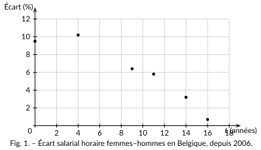

<!-- GÉNÉRÉ par typweb à partir des notes Typst : NE PAS ÉDITER (les modifications seraient écrasées). -->

Suivons un vrai indicateur de société : l’**écart salarial** entre les femmes et les hommes en Belgique, c’est-à-dire de combien de pour cent le salaire horaire moyen des femmes est inférieur à celui des hommes.

::: {.tableau}
| Année | $t$ = année $- 2006$ | Écart horaire (%) |
|:---:|:---:|:---:|
| 2006 | 0 | 9,5 |
| 2010 | 4 | 10,2 |
| 2015 | 9 | 6,4 |
| 2017 | 11 | 5,8 |
| 2020 | 14 | 3,2 |
| 2022 | 16 | 0,7 |
:::

Source : Eurostat, *Gender pay gap in unadjusted form* (code sdg\_05\_20), écart salarial horaire, Belgique. \
 Pour simplifier les calculs, on compte les années à partir de 2006 (colonne $t$).

::: {#activite-2-1 data-sorte="activite" data-num="2.1" data-page="8" data-phys="11" data-id="5UAA1.voir-tendance" data-type="activite" data-tags="" .theo .theo-activite}
::: {.theo-head}
**Activité 2.1** — voir la tendance
:::

::: {.theo-body}
Voici le nuage de ces six couples $(t ; y)$.

::: {.typst-fig}
{fig-alt="Figure du cours"}
:::

a) Le nuage est-il croissant ou décroissant ? [décroissant]{.rep}

b) En une phrase, que raconte-t-il ?

::: {.rep-bloc}
En Belgique, l’écart de salaire horaire entre femmes et hommes a fortement **diminué** depuis 2006 : d’environ $10 \%$, il est passé sous $1 \%$ en 2022. Les points sont assez bien alignés : une droite les résumerait correctement.
:::
:::
:::
