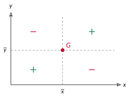

<!-- GÉNÉRÉ par typweb à partir des notes Typst : NE PAS ÉDITER (les modifications seraient écrasées). -->

Avant de chercher « la meilleure droite », posons une question plus simple : comment *un seul nombre* pourrait-il dire si $x$ et $y$ varient ensemble ? L’idée est de regarder chaque point par rapport au **point moyen $G$**.

::: {#activite-2-2 data-sorte="activite" data-num="2.2" data-page="9" data-phys="12" data-id="5UAA1.signe-revele-sens" data-type="activite" data-tags="" .theo .theo-activite}
::: {.theo-head}
**Activité 2.2** — le signe qui révèle le sens
:::

::: {.theo-body}
Traçons par $G$ deux droites : la verticale $x = \overline{x}$ et l’horizontale $y = \overline{y}$. Elles partagent le plan en quatre zones.

::: {.typst-fig}
{fig-alt="Figure du cours"}
:::

Pour chaque point, on note son **écart en $x$** ($x_{i} - \overline{x}$) et son **écart en $y$** ($y_{i} - \overline{y}$).

a) Quel est le signe de leur **produit** selon la zone ? Un point en haut à droite de $G$ a ses deux écarts positifs, donc un produit [positif]{.rep} ; un point en haut à gauche a un produit [négatif]{.rep}.

b) Vérifions-le sur quatre années de l’écart salarial ($\overline{x} = 9$, $\overline{y} \approx 5{,}97$). Complète les signes :

::: {.tableau}
| Année | signe de $x_{i} - \overline{x}$ | signe de $y_{i} - \overline{y}$ | signe du produit |
|:---:|:---:|:---:|:---:|
| 2006 | [$-$]{.rep} | [$+$]{.rep} | [$-$]{.rep} |
| 2010 | [$-$]{.rep} | [$+$]{.rep} | [$-$]{.rep} |
| 2020 | [$+$]{.rep} | [$-$]{.rep} | [$-$]{.rep} |
| 2022 | [$+$]{.rep} | [$-$]{.rep} | [$-$]{.rep} |
:::

c) Tous les produits sont négatifs : le nuage est donc plutôt [décroissant]{.rep}. Si, au contraire, les produits étaient majoritairement positifs, le nuage serait [croissant]{.rep}.
:::
:::

Ce que tu viens d’examiner point par point porte un nom : en faisant la **moyenne** de tous ces produits, on obtient la **covariance**.

::: {#definition-2-2 data-sorte="definition" data-num="2.2" data-page="10" data-phys="13" data-id="5UAA1.covariance" data-type="definition" data-tags="" .theo .theo-definition}
::: {.theo-head}
**Définition 2.2** — covariance
:::

::: {.theo-body}
La **covariance** de $x$ et $y$ est la moyenne des produits des écarts à leurs moyennes :

$$
\text{cov}(x, y) = \frac{1}{N} \sum (x_{i} - \overline{x})(y_{i} - \overline{y}).
$$

Son **signe** donne le **sens** du lien : **positive** si $x$ et $y$ augmentent ensemble, **négative** s’ils varient en sens contraire, proche de $0$ s’il n’y a pas de tendance nette.
:::
:::
