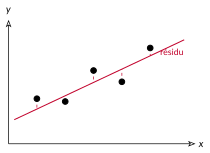
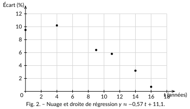

<!-- GÉNÉRÉ par typweb à partir des notes Typst : NE PAS ÉDITER (les modifications seraient écrasées). -->

La droite de Mayer est simple, mais elle ne regarde que deux points moyens. La méthode des **moindres carrés** utilise *tous* les points, en rendant la droite « aussi proche que possible » de l’ensemble.

Pour chaque point, on mesure l’**écart vertical** entre le point et la droite (on l’appelle un **résidu**). Une droite est d’autant meilleure que ces écarts sont petits.

::: {.typst-fig}
{fig-alt="Figure du cours"}
:::

::: {#definition-2-3 data-sorte="definition" data-num="2.3" data-page="11" data-phys="14" data-id="5UAA1.droite-regression-moindres-carres" data-type="definition" data-tags="" .theo .theo-definition}
::: {.theo-head}
**Définition 2.3** — droite de régression (moindres carrés)
:::

::: {.theo-body}
La **droite de régression** par la méthode des moindres carrés est l’unique droite $y = a x + b$ qui rend **la plus petite possible** la **somme des carrés des résidus**. On élève les écarts au carré pour que les écarts positifs et négatifs ne se compensent pas, et pour pénaliser les gros écarts. Cette droite passe elle aussi par le point moyen $G$.
:::
:::

On cherche la droite qui rend **minimale** la somme des carrés des résidus. On admet le résultat, mais sa forme se *comprend* à partir de ce qui précède :

::: {#propriete-2-2 data-sorte="propriete" data-num="2.2" data-page="11" data-phys="14" data-id="5UAA1.pente-droite-regression" data-type="propriete" data-tags="" .theo .theo-propriete}
::: {.theo-head}
**Propriété 2.2** — pente de la droite de régression
:::

::: {.theo-body}
$$
a = \frac{\text{cov}(x, y)}{\text{variance}(x)} = \frac{\sum (x_{i} - \overline{x})(y_{i} - \overline{y})}{\sum (x_{i} - \overline{x})^{2}}, \quad \quad b = \overline{y} - a \overline{x}.
$$

Au numérateur, la **co-variation** de $x$ et $y$ (leur tendance à bouger ensemble, que tu viens de mesurer) ; au dénominateur, l’**étalement** de $x$ seul. La pente dit donc « de combien $y$ bouge quand $x$ bouge ». Et comme $b = \overline{y} - a \overline{x}$, la droite passe **par le point moyen** $G$.
:::
:::

Reste à calculer $\text{cov}(x, y)$ et $\text{variance}(x)$. On pourrait revenir aux écarts un à un, mais il existe une écriture **équivalente** bien plus rapide, qui évite la colonne des écarts.

::: {#propriete-2-3 data-sorte="propriete" data-num="2.3" data-page="11" data-phys="14" data-id="5UAA1.formules-calcul" data-type="propriete" data-tags="" .theo .theo-propriete}
::: {.theo-head}
**Propriété 2.3** — formules de calcul
:::

::: {.theo-body}
$$
\text{variance}(x) = \frac{1}{N} \sum x_{i}^{2} - (\overline{x})^{2} \quad \quad \text{cov}(x, y) = \frac{1}{N} \sum x_{i} y_{i} - \overline{x} \ \overline{y}.
$$

En mots : **moyenne des carrés $-$ carré de la moyenne** pour la variance ; **moyenne des produits $-$ produit des moyennes** pour la covariance. L’**écart-type** $\sigma_{x} = \sqrt{\text{variance}(x)}$ mesure la dispersion de $x$.
:::
:::

::: {#remarque-2-2 data-sorte="remarque" data-num="2.2" data-page="11" data-phys="14" data-id="5UAA1.rem.004" data-type="remarque" data-tags="" .theo .theo-remarque}
::: {.theo-head}
**Remarque 2.2**
:::

::: {.theo-body}
Pourquoi « moyenne des carrés $-$ carré de la moyenne » mesure-t-il la dispersion ? Si toutes les valeurs étaient **égales**, la moyenne des carrés vaudrait exactement le carré de la moyenne : la variance serait nulle. Plus les valeurs s’écartent de leur moyenne, plus la moyenne des carrés **dépasse** le carré de la moyenne — et c’est cet excédent qui mesure l’étalement. La covariance suit la même idée, avec des *produits* à la place des carrés.
:::
:::

Ces formules ne réclament qu’un tableau à **quelques colonnes** : les valeurs, leurs carrés et leurs produits — aucune colonne d’écarts.

::: {#exemple-2-2 data-sorte="exemple" data-num="2.2" data-page="12" data-phys="15" data-id="5UAA1.pente-depuis-seul-tableau" data-type="exemple" data-tags="" .theo .theo-exemple}
::: {.theo-head}
**Exemple 2.2** — la pente depuis un seul tableau
:::

::: {.theo-body}
On dresse le tableau pour l’écart salarial :

::: {.tableau}
| $t$ | $y$ | $t^{2}$ | $y^{2}$ | $t y$ |
|:---:|:---:|:---:|:---:|:---:|
| 0 | 9,5 | 0 | 90,25 | 0 |
| 4 | 10,2 | 16 | 104,04 | 40,8 |
| 9 | 6,4 | 81 | 40,96 | 57,6 |
| 11 | 5,8 | 121 | 33,64 | 63,8 |
| 14 | 3,2 | 196 | 10,24 | 44,8 |
| 16 | 0,7 | 256 | 0,49 | 11,2 |
:::

Sommes : $\sum t = 54$, $\sum y = 35{,}8$, $\sum t^{2} = 670$, $\sum y^{2} = 279{,}62$, $\sum t y = 218{,}2$, avec $N = 6$.

Moyennes : $\overline{t} = 54 \div 6 = 9$ et $\overline{y} = 35{,}8 \div 6 \approx 5{,}97$.

$$
\text{variance}(t) = 670 \div 6 - 9^{2} \approx 111{,}7 - 81 = 30{,}7.
$$

$$
\text{cov}(t, y) = 218{,}2 \div 6 - 9 \times 5{,}97 \approx 36{,}4 - 53{,}7 = - 17{,}3.
$$

$$
a = \frac{\text{cov}(t, y)}{\text{variance}(t)} = \frac{- 17{,}3}{30{,}7} \approx - 0{,}57, \quad b = 5{,}97 - (- 0{,}57) \times 9 \approx 11{,}1.
$$

Droite de régression : $y \approx - 0{,}57 t + 11{,}1$ — très proche de la droite de Mayer ($- 0{,}59 t + 11{,}2$). La colonne $y^{2}$ resservira au chapitre 3 pour le coefficient de corrélation.
:::
:::

::: {#activite-2-3 data-sorte="activite" data-num="2.3" data-page="12" data-phys="15" data-id="5UAA1.obtenir-droite-calculatrice" data-type="activite" data-tags="" .theo .theo-activite}
::: {.theo-head}
**Activité 2.3** — obtenir la droite à la calculatrice
:::

::: {.theo-body}
En pratique, on ne calcule pas ces sommes à la main : la calculatrice le fait. Sur ta machine, entre dans le mode **statistiques à deux variables**, saisis les couples $(t ; y)$, puis lis la **régression linéaire** ($a x + b$). Note ce que tu obtiens : $a \approx$ [$-0{,}57$]{.rep} $b \approx$ [$11{,}1$]{.rep}

Voici la droite superposée au nuage :

::: {.typst-fig}
{fig-alt="Figure du cours"}
:::
:::
:::
