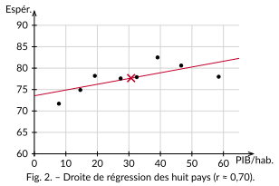

<!-- GÉNÉRÉ par typweb à partir des notes Typst : NE PAS ÉDITER (les modifications seraient écrasées). -->

::: {#exercice-2-1 data-sorte="exercice" data-num="2.1" data-page="13" data-phys="16" data-id="5UAA1.ex.005" data-type="exercice" data-tags="" .exo}
::: {.exo-tete}
[✎ Exercice 2.1]{.exo-titre} [[A2]{.exo-comp} ★☆☆]{.exo-meta}
:::

::: {.exo-corps}
On donne cinq points, déjà rangés : $(1 ; 2)$, $(2 ; 5)$, $(3 ; 5)$, $(4 ; 8)$, $(5 ; 10)$. Le point du milieu ($3 ; 5$) est laissé de côté pour équilibrer les groupes.

::: {.colonnes style="--n:2"}
- Calcule $G_{1}$ (les deux premiers points) et $G_{2}$ (les deux derniers).
- Détermine la pente puis l’équation de la droite de Mayer.
- Vérifie qu’elle passe par le point moyen $G$ des cinq points.
:::
:::
:::

::: {.aides}
::: {.panel-tabset}
## Indice 1 {.unlisted}

Revois la *Définition — droite de Mayer* et l’*Exemple — Mayer sur l’écart salarial*.

## Indice 2 {.unlisted}

*Question à te poser.* Comment obtient-on le point moyen d’un petit groupe ? Puis, avec deux points, comment calcule-t-on une pente $\Delta y / \Delta x$ ?

## Indice 3 {.unlisted}

*Étape.* $G_{1} = (\frac{1+2}{2} \, ; \, \frac{2+5}{2})$ ; de même $G_{2}$ avec les deux derniers. Ensuite $a = \frac{y_{G_{2}} - y_{G_{1}}}{x_{G_{2}} - x_{G_{1}}}$.

## Solution {.unlisted}

$G_{1} = (1{,}5 \, ; \, 3{,}5)$, $G_{2} = (4{,}5 \, ; \, 9)$. $a = \frac{9 - 3{,}5}{4{,}5 - 1{,}5} = \frac{5{,}5}{3} \approx 1{,}83$ ; via $G_{1}$ : $b = 3{,}5 - 1{,}83 \cdot 1{,}5 \approx 0{,}75$. Donc $y \approx 1{,}83 \, x + 0{,}75$. Point moyen des cinq : $G(3 \, ; \, 6)$, et $1{,}83 \cdot 3 + 0{,}75 \approx 6{,}25$ : la droite passe tout près de $G$. ✓

## Pièges {.unlisted}

« Séparer » un couple entre les deux groupes ; classer selon $y$ au lieu de $x$.
:::
:::

::: {#exercice-2-2 data-sorte="exercice" data-num="2.2" data-page="13" data-phys="16" data-id="5UAA1.ex.006" data-type="exercice" data-tags="" .exo}
::: {.exo-tete}
[✎ Exercice 2.2]{.exo-titre} [[A3]{.exo-comp} ★★☆]{.exo-meta}
:::

::: {.exo-corps}
Reprends les cinq points de l’exercice précédent. Dresse un tableau à colonnes $x_{i}$, $y_{i}$, $x_{i}^{2}$, $x_{i} y_{i}$ (quatre colonnes suffisent pour la pente), calcule $\text{variance}(x)$ et $\text{cov}(x, y)$ par les **formules développées**, puis déduis-en l’équation de la **droite de régression**. Compare sa pente à celle de la droite de Mayer : sont-elles proches ?
:::
:::

::: {.aides}
::: {.panel-tabset}
## Indice 1 {.unlisted}

Revois les *Propriétés — pente de la droite de régression* et **formules de calcul développées**, ainsi que l’*Exemple — la pente depuis un seul tableau*.

## Indice 2 {.unlisted}

*Question à te poser.* Quelles sommes te faut-il pour la variance ($\sum x^{2}$) et pour la covariance ($\sum x y$) ? Que valent $\overline{x}$ et $\overline{y}$ ?

## Indice 3 {.unlisted}

*Étape.* $\text{variance} (x) = \frac{\sum x^{2}}{N} - \overline{x} ^2$ et $\text{cov} (x,y) = \frac{\sum x y}{N} - \overline{x} \, \overline{y}$, puis $a = \text{cov} / \text{variance} (x)$ et $b = \overline{y} - a \overline{x}$.

## Solution {.unlisted}

$\sum x = 15, \ \sum y = 30, \ \sum x^{2} = 55, \ \sum x y = 109, \ N = 5$ ; $\overline{x} = 3, \ \overline{y} = 6$. $\text{variance} (x) = \frac{55}{5} - 9 = 2$ ; $\text{cov} (x,y) = \frac{109}{5} - 18 = 3{,}8$. $a = \frac{3{,}8}{2} = 1{,}9$ ; $b = 6 - 1{,}9 \cdot 3 = 0{,}3$. Donc $y = 1{,}9 \, x + 0{,}3$ — pente très proche de celle de Mayer ($1{,}83$).

## Pièges {.unlisted}

Diviser $\sum x^{2}$ par $N$ mais oublier de retrancher $\overline{x} ^2$ ; confondre $\sum x^{2}$ (somme des carrés) et $(\sum x)^{2}$ (carré de la somme).
:::
:::

::: {#exercice-2-3 data-sorte="exercice" data-num="2.3" data-page="13" data-phys="16" data-id="5UAA1.ex.007" data-type="exercice" data-tags="" .exo}
::: {.exo-tete}
[✎ Exercice 2.3]{.exo-titre} [[C5]{.exo-comp} ★★☆]{.exo-meta}
:::

::: {.exo-corps}
Un camarade a tracé « au jugé » une droite qui passe *au-dessus* de tous les points d’un nuage. En raisonnant sur les **résidus**, explique pourquoi ce ne peut pas être la droite des moindres carrés.
:::
:::

::: {.aides}
::: {.panel-tabset}
## Indice 1 {.unlisted}

Revois la *Définition — droite de régression (moindres carrés)* : que minimise-t-elle ? Rejoue la figure interactive du cours.

## Indice 2 {.unlisted}

*Question à te poser.* Si la droite est au-dessus de tous les points, quel est le **signe** de chaque résidu ? En **descendant** la droite, la somme des carrés augmente-t-elle ou diminue-t-elle ?

## Indice 3 {.unlisted}

*Étape.* Compare la somme des carrés avant et après avoir abaissé la droite vers le nuage.

## Solution {.unlisted}

Si la droite est au-dessus de tous les points, **tous** les résidus ont le même signe et sont grands. En abaissant la droite vers le nuage, on **réduit** chaque écart, donc la **somme des carrés diminue** : la droite de départ n’était donc pas celle qui la rend minimale. La droite des moindres carrés laisse forcément des points **de part et d’autre** (et passe par $G$).

## Pièges {.unlisted}

Croire qu’« au-dessus » veut dire « proche » ; oublier que c’est la somme des **carrés** qu’on minimise, pas le nombre de points touchés.
:::
:::

::: {#exercice-2-4 data-sorte="exercice" data-num="2.4" data-page="14" data-phys="17" data-id="5UAA1.ex.008" data-type="exercice" data-tags="" .exo}
::: {.exo-tete}
[✎ Exercice 2.4]{.exo-titre} [[A4]{.exo-comp} ★★☆]{.exo-meta}
:::

::: {.exo-corps}
On relève, pour huit pays, le PIB par habitant $x$ (milliers de \$) et l’espérance de vie $y$ (données du chapitre 1, Our World in Data 2022).

::: {.tableau}
| $x$ | 7,8 | 14,6 | 19,2 | 27,4 | 32,5 | 39,1 | 46,6 | 58,5 |
|:---:|:---:|:---:|:---:|:---:|:---:|:---:|:---:|:---:|
| $y$ | 71,7 | 74,9 | 78,2 | 77,6 | 77,9 | 82,5 | 80,6 | 78,0 |
:::

a) À la calculatrice, donne l’équation de la droite de régression.

b) La pente est positive : qu’est-ce que cela signifie, concrètement, sur le lien entre richesse et espérance de vie ?
:::
:::

::: {.aides}
::: {.panel-tabset}
## Indice 1 {.unlisted}

Revois l’*Exemple — la pente depuis un seul tableau* : la calculatrice applique exactement ces formules.

## Indice 2 {.unlisted}

*Question à te poser.* En mode statistique à deux variables, quelles touches donnent $a$ et $b$ ? Une pente de « $0{,}13$ » se lit : quand $x$ augmente de **1**, de combien augmente $y$ ?

## Indice 3 {.unlisted}

*Étape.* Saisis les huit couples, lis la régression linéaire $a x + b$, puis traduis $a$ en « années gagnées par millier de dollars ».

## Solution {.unlisted}

Environ $y \approx 0{,}13 \, x + 73{,}5$. La pente $0{,}13$ signifie qu’en moyenne, **1000 \$ de PIB/hab. en plus s’accompagnent d’environ 0,13 année d’espérance de vie en plus** — sur cet échantillon, et sans que cela prouve une cause (chapitre 3).

::: {.typst-fig}
{fig-alt="Figure du cours"}
:::

## Pièges {.unlisted}

Donner la pente « à l’envers » (confondre $a$ et $b$) ; conclure à une **cause** alors qu’on n’a qu’une **corrélation**.
:::
:::
