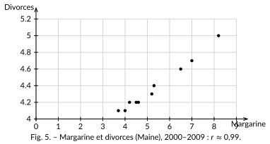

<!-- GÉNÉRÉ par typweb à partir des notes Typst : NE PAS ÉDITER (les modifications seraient écrasées). -->

Un $r$ proche de $1$ dit que deux variables **varient ensemble**. Il ne dit *jamais*, à lui seul, que l’une **cause** l’autre. L’exemple suivant le montre de façon spectaculaire.

::: {#activite-3-2 data-sorte="activite" data-num="3.2" data-page="17" data-phys="20" data-id="5UAA1.margarine-divorces" data-type="activite" data-tags="" .theo .theo-activite}
::: {.theo-head}
**Activité 3.2** — margarine et divorces
:::

::: {.theo-body}
Aux États-Unis, entre 2000 et 2009, on a relevé la consommation de margarine par habitant ($x$, en livres) et le taux de divorces dans l’État du Maine ($y$, pour $1000$ habitants).

::: {.tableau}
| $x$ | 8,2 | 7,0 | 6,5 | 5,3 | 5,2 | 4,0 | 4,6 | 4,5 | 4,2 | 3,7 |
|:---:|:---:|:---:|:---:|:---:|:---:|:---:|:---:|:---:|:---:|:---:|
| $y$ | 5,0 | 4,7 | 4,6 | 4,4 | 4,3 | 4,1 | 4,2 | 4,2 | 4,2 | 4,1 |
:::

::: {.typst-fig}
{fig-alt="Figure du cours"}
:::

Source : USDA (margarine) et CDC, National Vital Statistics (divorces), compilés par T. Vigen, *Spurious Correlations*.

a) Que vaut approximativement $r$ ? Le lien est-il fort ? [$r \approx 0{,}99$ : lien très fort.]{.rep}

b) Manger moins de margarine réduit-il vraiment les divorces ?

::: {.rep-bloc}
Bien sûr que non. Les deux quantités ont simplement **baissé en même temps** durant ces années, sans aucun rapport de cause à effet. Une corrélation, même parfaite, ne prouve rien à elle seule.
:::
:::
:::

Quand deux variables sont corrélées, il y a **trois explications possibles**, et il faut se demander laquelle est vraie :

::: {#cadre-57 .cadre-info}
- **Cause à effet** — $x$ agit réellement sur $y$ (p. ex. plus on chauffe une pièce, plus la température monte).
- **Variable cachée** — un troisième facteur agit sur $x$ *et* sur $y$ (p. ex. dans une grande ville, il y a à la fois plus de policiers et plus de délits : la vraie cause commune est la *taille* de la ville).
- **Coïncidence** — pur hasard, fréquent quand on cherche des liens partout (margarine et divorces).
:::

::: {#remarque-3-2 data-sorte="remarque" data-num="3.2" data-page="18" data-phys="21" data-id="5UAA1.rem.006" data-type="remarque" data-tags="" .theo .theo-remarque}
::: {.theo-head}
**Remarque 3.2**
:::

::: {.theo-body}
C’est pourquoi il faut se méfier des débats où l’on relie deux phénomènes de société en montrant qu’ils « vont ensemble ». Un nuage de points ne suffit jamais à établir une cause : il faut écarter les variables cachées et le hasard.
:::
:::
