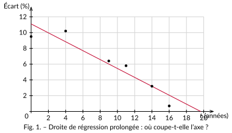

<!-- GÉNÉRÉ par typweb à partir des notes Typst : NE PAS ÉDITER (les modifications seraient écrasées). -->

::: {#definition-4-1 data-sorte="definition" data-num="4.1" data-page="20" data-phys="23" data-id="5UAA1.interpolation-extrapolation" data-type="definition" data-tags="" .theo .theo-definition}
::: {.theo-head}
**Définition 4.1** — interpolation, extrapolation
:::

::: {.theo-body}
À partir de la droite de régression $y = a x + b$, on peut estimer un $y$ pour une valeur de $x$ non mesurée.

- **Interpoler**, c’est estimer à l’*intérieur* de l’intervalle des données observées : assez sûr.
- **Extrapoler**, c’est estimer à l’*extérieur* (avant la première donnée ou après la dernière) : beaucoup plus risqué.
:::
:::

::: {#exemple-4-1 data-sorte="exemple" data-num="4.1" data-page="20" data-phys="23" data-id="5UAA1.prevoir-ecart-salarial" data-type="exemple" data-tags="" .theo .theo-exemple}
::: {.theo-head}
**Exemple 4.1** — prévoir l’écart salarial
:::

::: {.theo-body}
On reprend la droite de régression du chapitre 2 : $y \approx - 0{,}57 t + 11{,}1$ (avec $t$ = année $- 2006$, données $2006$–$2022$).

**Interpolation** — estimer l’écart en 2013 ($t = 7$, entre 2006 et 2022) :

$$
y \approx - 0{,}57 \times 7 + 11{,}1 \approx 7{,}1 \%.
$$

**Extrapolation** — en quelle année le modèle prévoit-il un écart *nul* ? On résout $0 = -0{,}57 t + 11{,}1$, soit

$$
t \approx \frac{11{,}1}{0{,}57} \approx 19{,}5,
$$

c’est-à-dire vers **2025 – 2026**. C’est une extrapolation : on sort de l’intervalle des données.
:::
:::

::: {#activite-4-1 data-sorte="activite" data-num="4.1" data-page="21" data-phys="24" data-id="5UAA1.jusqu-prolonger-droite" data-type="activite" data-tags="" .theo .theo-activite}
::: {.theo-head}
**Activité 4.1** — jusqu’où prolonger la droite ?
:::

::: {.theo-body}
La droite est prolongée ci-dessous au-delà de la dernière donnée (2022, soit $t = 16$).

::: {.typst-fig}
{fig-alt="Figure du cours"}
:::

a) Vers quelle valeur de $t$ la droite atteint-elle $0$ ? [$t \approx 19{,}5$ (année $\approx 2025$)]{.rep}

b) Peut-on en conclure qu’il n’y aura *plus aucune* inégalité salariale en 2025 ? Réfléchis avant de répondre à la section suivante.

::: {.rep-bloc}
Non : voir ci-dessous. Rien ne garantit que la baisse se poursuive au même rythme, et un écart horaire nul ne signifie pas l’égalité réelle.
:::
:::
:::
